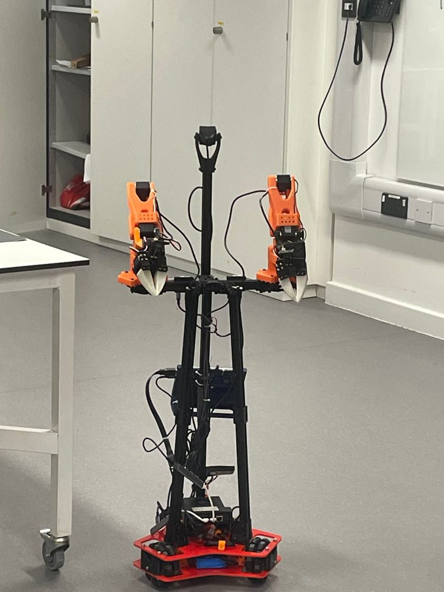
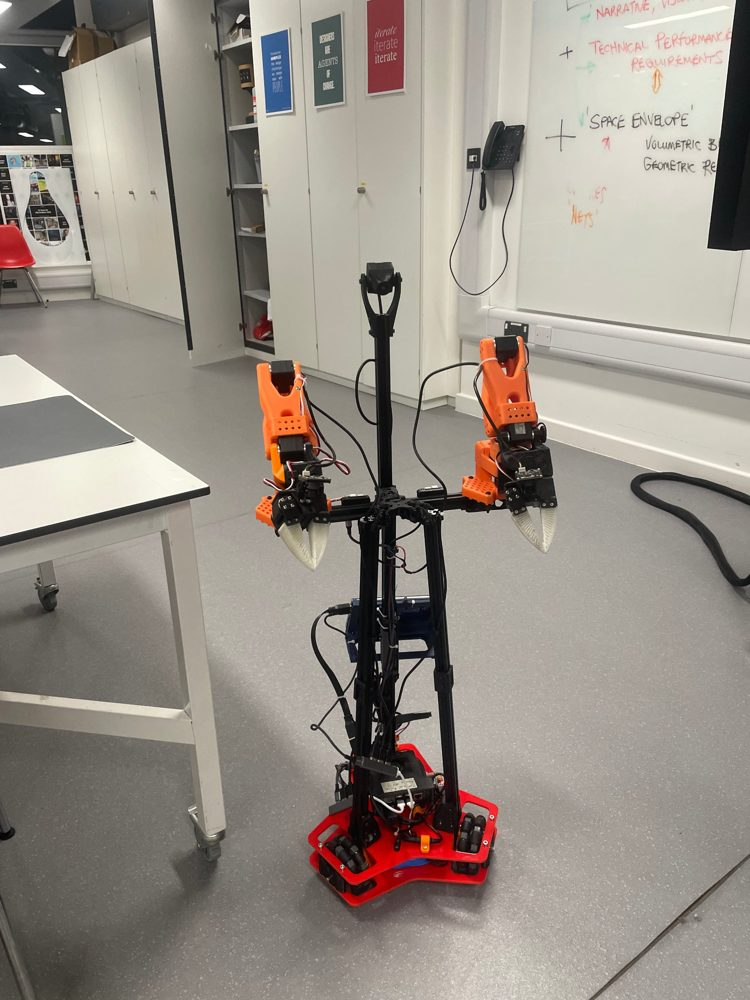
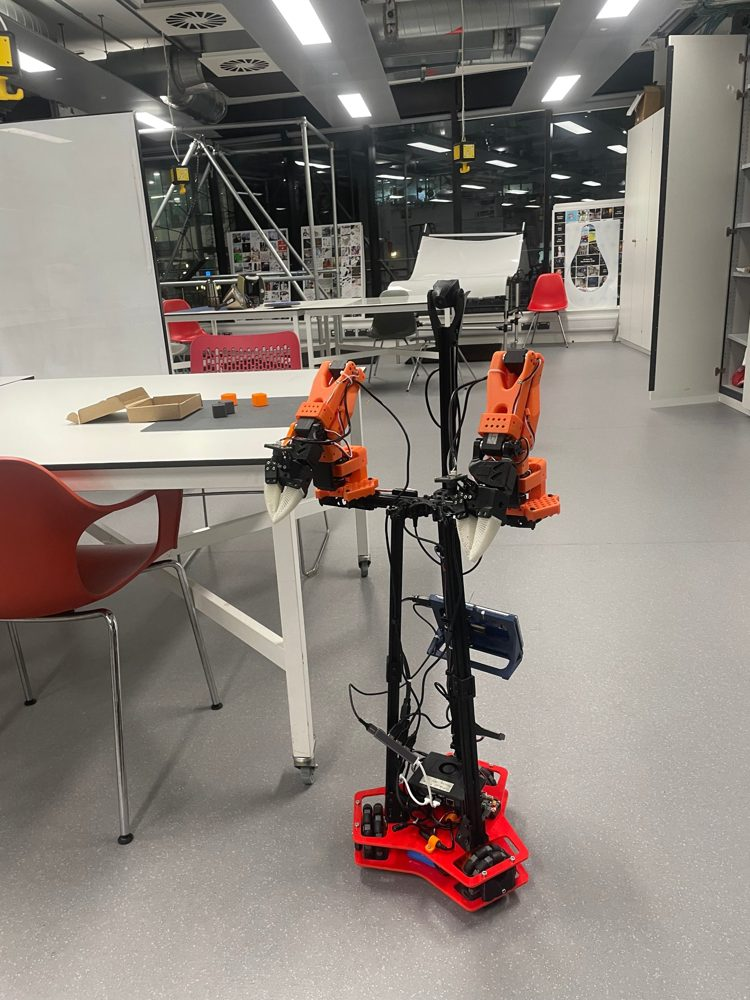
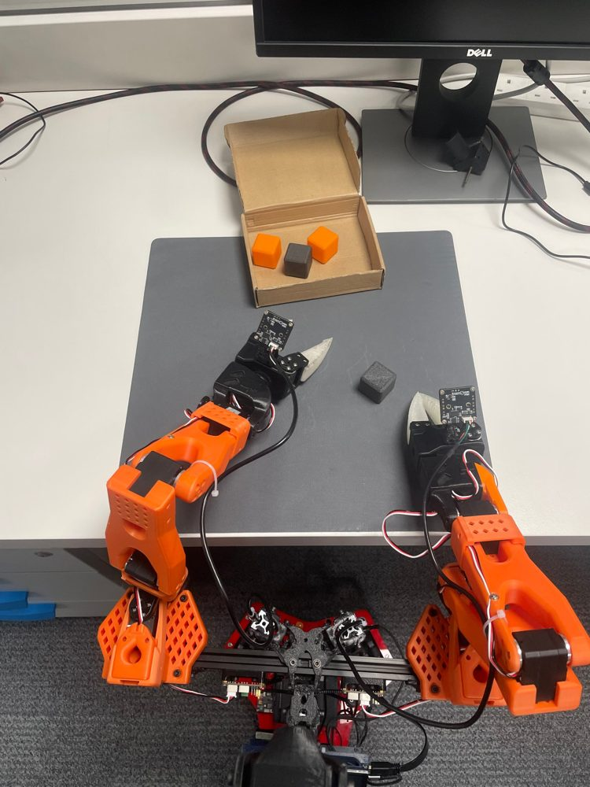
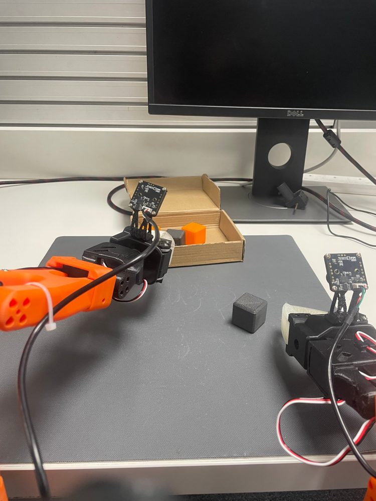

<h1 align="center">OB-15 · a mobile bimanual robot on LeRobot</h1>

<p align="center">
  
  
  
</p>

This is [ImpurestTadpole](https://github.com/ImpurestTadpole)'s fork of [huggingface/lerobot](https://github.com/huggingface/lerobot).
It adds the **OB-15** robot, a Meta Quest VR teleoperator, a co-training data pipeline, and the tools I use to collect data, train and deploy policies on it.

- `main` follows upstream. I merge `huggingface/lerobot` `main` into it regularly.
- All upstream features still work. See [Upstream LeRobot](#upstream-lerobot) at the end.
- OB-15 started as an [XLeRobot](https://github.com/Vector-Wangel/XLeRobot)-style build. Some names (the `xlerobot_vr` teleoperator, the "xlerobot schema" in the guides) still use that name.

---

## Contents

1. [Status at a glance](#status-at-a-glance)
2. [The hardware](#the-hardware)
3. [Everything this fork adds](#everything-this-fork-adds)
4. [Branches](#branches)
5. [How it went: results and lessons](#how-it-went-results-and-lessons)
6. [Quick start](#quick-start)
7. [Next steps](#next-steps)
8. [Upstream LeRobot](#upstream-lerobot)

---

## Status at a glance

| Area | Status | Short result |
|---|---|---|
| OB-15 robot class (`ob15`) | ✅ In use | Arms, head, base and lift run from one `Robot` class. |
| Remote mode (`ob15_client` + host) | ✅ In use | Jetson drives the hardware. A GPU PC runs the policy over ZMQ. |
| Gantry lift axis | ✅ In use, hardened | Works. Needed stall, temperature and stop-on-exit guards. |
| Quest VR teleop (`xlerobot_vr`) | ✅ In use | Controls head, lift, base, both arms and grippers at once. |
| RealSense depth recording | ✅ In use | Depth costs loop rate. Tuned to 424×240 at ~10 Hz. |
| Whole-body VR datasets → policy | ⚠️ Low success | Head, base and lift drift plus inaccurate grasps. |
| Arms-only robot (`ob15_arms`) | 🧪 On branches | Fixed head/lift pose per dataset. Policy controls arms only. |
| Co-training pipeline + workflow UI | 🧪 Built, in testing | Merge, align, retarget, weight and train from one UI. |
| HVLA (dual-system VLA) | 🧪 Integrated | S2 VLM + S1 action policy. Runs at ~29 Hz on the S1 loop. |
| DAgger / human-in-the-loop | 🧪 Fixes on branches | Rollout + VR takeover. Several bugs fixed for OB-15. |
| GEM 7-DOF arm (`gem`, `bi_gem`) | 🧪 Experimental | ODrive + Feetech arm. Unit tests use mocked buses. |

✅ = used on the robot. ⚠️ = works, but results were poor. 🧪 = built, still being tested.

---

## The hardware

<p align="center">
  
  
</p>

| Component | Details |
|---|---|
| Mobile base | 3 omni-wheels at 120°, velocity control, Feetech STS3215 |
| Left arm | 6-DOF SO-101-style arm (shoulder pan/lift, elbow, wrist flex/roll, gripper), STS3215 on Bus 1 |
| Right arm | 6-DOF, same layout, STS3215 on Bus 2 |
| Head | 2-DOF pan + tilt, STS3215 on Bus 2 |
| Gantry lift | Optional Z axis. Leadscrew 100 mm/rev, 575 mm stroke. One STS3215, Bus 2, ID 9 |
| Head camera | Intel RealSense D435i, 640×360 RGB at 30 fps + depth |
| Wrist cameras | 2× Innomaker USB, 640×360 MJPG at 30 fps |
| Compute | NVIDIA Jetson on the robot. Optional GPU workstation over ZMQ |

**Motor buses**

- **Bus 1** (`/dev/ttyACM1`): left arm IDs 1–6, base wheels IDs 7–9.
- **Bus 2** (`/dev/ttyACM0`): right arm IDs 1–6, head IDs 7–8, lift ID 9.

**State and action (18 values):** `left_arm_*.pos` ×6, `right_arm_*.pos` ×6, `head_pan.pos`, `head_tilt.pos`, `x.vel`, `y.vel`, `theta.vel`, `gantry.height_mm`.
**Cameras:** `head` (+ `head_depth`), `left_wrist`, `right_wrist`. These names match SmolVLA's three image inputs, so no rename map is needed.

---

## Everything this fork adds

Paths are relative to the repo root. "Status" uses the same legend as above.

### Robots and motors

| Path | What it does | Status |
|---|---|---|
| `src/lerobot/robots/ob15/ob15.py`, `config_ob15.py` | OB-15 robot (`--robot.type=ob15`). Per-limb ports that collapse onto shared buses, base velocity smoothing, camera start order. | ✅ |
| `src/lerobot/robots/ob15/lift_axis.py` | Gantry lift: homing to stall, mm ↔ steps, velocity mode with wrap tracking, soft limits. | ✅ |
| `src/lerobot/robots/ob15/ob15_host.py`, `ob15_client.py` | ZMQ host on the Jetson and `ob15_client` robot on the GPU PC. Watchdog, JPEG streaming. | ✅ |
| `src/lerobot/robots/ob15/scripts/deadband_calibration.py` | Finds the smallest lift velocity that moves under load, in each direction. | ✅ |
| `src/lerobot/robots/gem_follower/`, `bi_gem_follower/` | GEM 7-DOF arm and dual-arm version with a neck. Joint 1 on ODrive, the rest on Feetech. | 🧪 |
| `src/lerobot/motors/odrive/` | `ODriveMotorsBus` for the GEM shoulder (extra: `lerobot[gem]`). | 🧪 |
| `src/lerobot/model/SO101Robot.py` | SO-101 kinematic model helper used by the EE converters. | ✅ |

### Teleoperation

| Path | What it does | Status |
|---|---|---|
| `src/lerobot/teleoperators/xlerobot_vr/` | Meta Quest teleop. Headset drives the head. Controllers drive arms (IK), grippers, lift and base. Streams cameras to the headset. Remappable `button_map`. | ✅ |
| `.../xlerobot_vr/vr_monitor.py` | HTTPS/WebSocket server and status monitor for the headset page. | ✅ |
| Recording buttons | Left X opens the recording gate. Left Y re-records. Right A saves. Right B toggles DAgger takeover. Hold left X restarts an episode. Headset chimes on events. | ✅ |

### Cameras and recording

| Path | What it does | Status |
|---|---|---|
| `src/lerobot/cameras/realsense/` | Depth capture with its own resolution and `depth_frame_interval`. Background read thread. | ✅ |
| `src/lerobot/cameras/opencv/camera_opencv.py` | Warm-up, start order and read fixes for the USB wrist cameras. | ✅ |
| `src/lerobot/scripts/lerobot_record.py` | VR recording gate, depth read interval, gantry keys, upload on request. | ✅ |
| `src/lerobot/utils/cycle_timer.py` | Loop-rate summary: tick percentiles, slow ticks, below-target warning. | ✅ |
| `src/lerobot/scripts/lerobot_find_cameras.py` | Better camera discovery for multiple USB + RealSense devices. | ✅ |
| `src/lerobot/datasets/recover_dataset.py` | Finalizes a dataset that recorded but did not finalize or upload. | ✅ |

### Data and co-training

| Path / CLI | What it does | Status |
|---|---|---|
| `lerobot-cotrain-align` (`data_processing/co_training_utils.py`) | Aligns ALOHA / Open-X / other LeRobot sets to the OB-15 schema: fps resample, joint remap by name, camera rename, padding report. | 🧪 |
| `lerobot-extract-subset` | Derives RGB-only or reduced-DOF views from one "master" RGB-D dataset. | 🧪 |
| `lerobot-umi-retarget` | Retargets UMI-style end-effector datasets (e.g. FastUMI) to the arms. | 🧪 |
| `lerobot-joint-to-ee`, `scripts/convert_joint_to_ee.py`, `scripts/convert_droid_ee.py` | Converts joint datasets and DROID to episode-relative EE actions. | 🧪 |
| `utils/dim_masking.py` | Masks the loss on padded action dims so a single-arm source does not teach a dead arm. | 🧪 |
| `datasets/sampler.py`, `utils/source_sampling.py`, `config/generalist_source_weights.yaml` | Memory-light episode sampler with per-source-group weights. | 🧪 |
| `utils/sample_weighting.py`, `rewards/sarm/*`, `data_processing/sarm_annotations/` | SARM subtask annotation and RA-BC sample weights. | 🧪 |
| `scripts/workflow_ui/` | Local web UI: compose merge/train/extract/SARM stages, compare datasets, run with live logs. | 🧪 |

### Training, policies and deployment

| Path | What it does | Status |
|---|---|---|
| `src/lerobot/policies/hvla/` | Hierarchical VLA. S2 = Pi0.5 VLM (latents). S1 = ACT or flow-matching action policy. Shared-memory IPC. RLT (RL token) experiments. | 🧪 |
| `scripts/extract_s2_latents_hvla.py`, `scripts/sync_hvla_deploy.sh` | Offline S2 latent extraction and deploy sync for HVLA. | 🧪 |
| `src/lerobot/scripts/lerobot_train.py`, `src/lerobot/configs/*` | Hooks for weighted sampling, dim masking and source groups. | 🧪 |
| `src/lerobot/upload_checkpoints.py` | Uploads many checkpoints to the Hub, with an LFS fallback. | ✅ |
| `src/lerobot/async_inference/` | Policy server + robot client (kept in this fork). Pi0.5 server accepts real camera/state shapes. | ✅ |
| `src/lerobot/rollout/strategies/dagger.py` | DAgger fixes: honours `push_to_hub`, `max_relative_target` on OB-15, empty teleop actions. | 🧪 |
| `examples/ros2_bridge/` | ROS 2 Humble (Python 3.10) ↔ LeRobot (Python 3.12) bridge over ZMQ. | 🧪 |
| `src/lerobot/policies/goodview_jepa/`, `examples/goodview_jepa/` | Good-View JEPA: VLA-JEPA with a cross-view world-model target (predict another camera's view), frame stride and training-time camera blanking. Encoder study scripts. See [docs](./docs/source/goodview_jepa.mdx). | 🧪 |

### Guides, scripts and tests

| File | Content |
|---|---|
| [`GUIDE.md`](./GUIDE.md) | Full co-training pipeline, step by step, with the workflow UI. |
| [`COTRAINING.md`](./COTRAINING.md) | Concepts and flags: merge, padding bias, generalist → specialists. |
| [`DATA_CONVERSION.md`](./DATA_CONVERSION.md) | External data → OB-15 schema. |
| [`DAGGER_HIL.md`](./DAGGER_HIL.md) | DAgger, RA-BC + SARM, HIL-SERL. |
| [`RGBD_IMPLEMENTATION_GUIDE.md`](./RGBD_IMPLEMENTATION_GUIDE.md) | 4-channel RGB-D training. |
| `Guide.sh` | My session reference: every hardware, record and train command. |
| `scripts/test_xlerobot.sh` | Hardware smoke test. |
| `tests/robots/test_ob15.py`, `test_gem_follower.py`, `test_bi_gem_follower.py`, `tests/teleoperators/test_xlerobot_vr_button_map.py`, `tests/async_inference/*`, `tests/data_processing/test_joint_to_ee.py` | Unit tests. Hardware is mocked. |

---

## Branches

| Branch | Purpose |
|---|---|
| `main` | Upstream + all stable OB-15 work. |
| `ob15-arms-robot` | `ob15_arms` robot: arms-only policy, fixed head tilt and lift height, lift stall/temperature guards, VR restart button. |
| `ob15-arms-rollout-gantry` | Rollout fixes: gantry height in the policy state, position hold, lift stops on exit. |
| `ob15-recording-rate` | Non-blocking camera reads, repeated-frame accounting, writer backlog log. |
| `ob15-arms` | Integration of the three branches above. |
| `pc1-training` | Training branch for the PC1 workstation (all of the above + dataset decode fixes). |

---

## How it went: results and lessons

**1. Whole-body VR teleop gave low policy success.**
I recorded datasets with the Quest controlling head, lift, base, both arms and grippers at the same time. The head moved a lot and the base moved during tasks. Trained policies mostly failed. The causes were drift in base, head and lift, and grasps that were not accurate.

**2. Fix: arms-only policies with a fixed pose.**
The `ob15_arms` robot holds the head and lift at a set pose. That pose is saved with each dataset and used again at inference. The policy controls only the arms and grippers. Base and lift move between tasks, not during them. Defaults: head tilt ≈ 60, lift 25 mm below the top.

**3. Depth costs loop rate.**
With depth at full colour resolution, the control loop fell from ~30 Hz to 15–29 Hz. Depth at 424×240 and decoded every third frame (~10 Hz) brought it back. The new cadence summary shows slow ticks so this is visible during recording.

**4. The lift needs guards.**
A velocity-mode lift can keep running if the program stops. I added stop-on-exit, stop after the connect hold, stall and temperature guards, and a deadband calibration script.

**5. The base is the stability limit.**
The wheel motors are small for the arm mass. Driving with the arms extended is the worst load case. Rule: drive, stop, then manipulate. This is a main input to the OB-20 design.

**6. HVLA runs fast enough.**
The HVLA docs report an S1 loop of ~34 ms (~29 Hz) with 10 flow-matching steps, compiled, in bf16. S2 adds ~81 ms per latent and runs in parallel.

---

## Quick start

```bash
git clone https://github.com/ImpurestTadpole/lerobot && cd lerobot
uv sync --locked --extra feetech --extra realsense --extra viz   # add --extra training on the GPU PC
```

**Calibrate** (once per robot; homes the lift if enabled):

```bash
lerobot-calibrate --robot.type=ob15 --robot.port1=/dev/ttyACM1 --robot.port2=/dev/ttyACM0 \
  --robot.lift_axis.enabled=true
```

**Teleoperate with the Quest** (on the Jetson):

```bash
lerobot-teleoperate --robot.type=ob15 --teleop.type=xlerobot_vr --teleop.stream_cameras_to_vr=true
```

**Record:**

```bash
lerobot-record --robot.type=ob15 --teleop.type=xlerobot_vr \
  --dataset.repo_id=<hf_user>/<task> --dataset.single_task="<task text>" \
  --dataset.num_episodes=20 --dataset.fps=30 --dataset.push_to_hub=true
```

**Remote mode** (Jetson runs hardware, GPU PC runs the policy):

```bash
# Jetson
python -m lerobot.robots.ob15.ob15_host --robot-config <profile>.json
# GPU PC: use --robot.type=ob15_client --robot.remote_ip=<jetson_ip>
```

**Co-training pipeline:**

```bash
uv run python scripts/workflow_ui/app.py   # → http://127.0.0.1:7799
```

Then follow [`GUIDE.md`](./GUIDE.md).

---

## Next steps

- Finish and merge `ob15_arms` into `main`.
- Reach 5–10 household tasks at ~90 % success with small datasets.
- Instant-Policy-style in-context imitation: wrap Instant Policy in LeRobot first, then a native demo- or language-prompted policy from SmolVLA weights.
- Move the stack to **OB-20** (CAN-native actuators, wider base, powered lift column).

---

## Upstream LeRobot

Everything else in this repo is [Hugging Face LeRobot](https://github.com/huggingface/lerobot): the `Robot` interface, the LeRobotDataset format, policies (ACT, Diffusion, Pi0/Pi0.5, SmolVLA, GR00T and more), `lerobot-train`, `lerobot-eval` and `lerobot-rollout`.

- Docs: <https://huggingface.co/docs/lerobot>
- Install, hardware and policy guides: [docs/source](./docs/source)
- Licence: Apache 2.0 ([LICENSE](./LICENSE))

If you use LeRobot, please cite the upstream project:

```bibtex
@misc{cadene2024lerobot,
    author = {Cadene, Remi and Alibert, Simon and Soare, Alexander and Gallouedec, Quentin and Zouitine, Adil and Palma, Steven and Kooijmans, Pepijn and Aractingi, Michel and Shukor, Mustafa and Aubakirova, Dana and Russi, Martino and Capuano, Francesco and Pascal, Caroline and Choghari, Jade and Meftah, Khalil and Ellerbach, Maxime and Moss, Jess and Wolf, Thomas},
    title = {LeRobot: State-of-the-art Machine Learning for Real-World Robotics in Pytorch},
    howpublished = "\url{https://github.com/huggingface/lerobot}",
    year = {2024}
}
```
